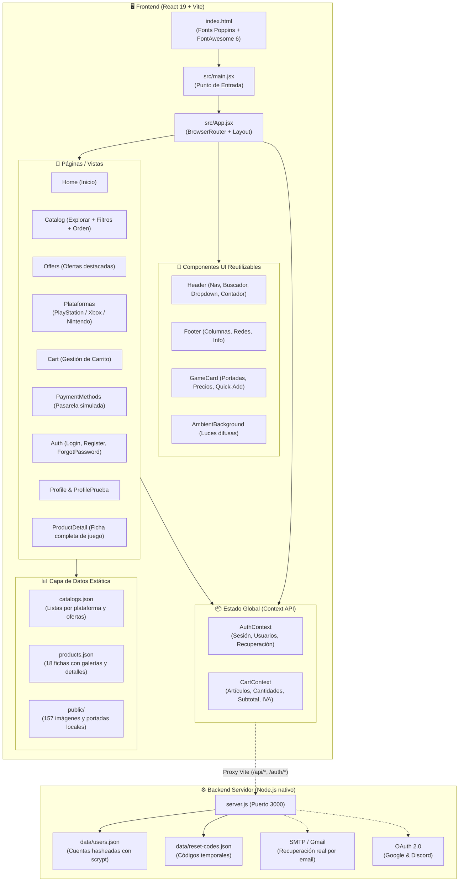

# 🎮 Pixel Store — Arquitectura del Proyecto

**Pixel Store** es una plataforma web de comercio electrónico y catálogo interactivo de videojuegos multiplataforma (PlayStation, Xbox y Nintendo), construida con **React 19**, **Vite** y **React Router**, conservando fielmente el diseño original de estilo oscuro con estética gamer, degradados y efectos *glassmorphism*.

---

## 📐 Diagrama de Arquitectura



---

## 📂 Estructura del Proyecto

```text
Pixel-Store-Final-react/
├── public/                          # Recursos estáticos locales
│   ├── favicon.svg                  # Favicon del sitio
│   ├── icons.svg                    # Iconos SVG de soporte
│   └── *.jpg / *.png                # 157 imágenes originales de videojuegos y logos
├── src/
│   ├── assets/                      # Recursos gráficos internos
│   ├── components/                  # Componentes reutilizables
│   │   ├── AmbientBackground.jsx    # Efectos luminosos de fondo (.ambient)
│   │   ├── Footer.jsx               # Pie de página global con enlaces y branding
│   │   ├── GameCard.jsx             # Tarjeta de juego interactiva con botón de carrito
│   │   └── Header.jsx               # Barra de navegación superior con buscador y perfil
│   ├── context/                     # Gestión de estado global (Context API)
│   │   ├── auth-context.js          # Definición del contexto de autenticación
│   │   ├── AuthContext.jsx          # Proveedor de autenticación (login, registro, perfil)
│   │   ├── cart-context.js          # Definición del contexto del carrito
│   │   ├── CartContext.jsx          # Proveedor del carrito (cálculos, persistencia)
│   │   ├── useAuth.js               # Hook personalizado useAuth()
│   │   └── useCart.js               # Hook personalizado useCart()
│   ├── data/                        # Datos extraídos y estructurados
│   │   ├── catalogs.json            # Juegos por sección (home, explorar, ofertas, consolas)
│   │   └── products.json            # Información completa de los 18 videojuegos
│   ├── pages/                       # Vistas principales de la aplicación
│   │   ├── Cart.jsx                 # Carrito de compras con cálculo de IVA y total
│   │   ├── Catalog.jsx              # Explorador con filtros por plataforma y ordenación
│   │   ├── ForgotPassword.jsx       # Recuperación de contraseña en 2 pasos
│   │   ├── Home.jsx                 # Página principal (index.html / indexiniciada.html)
│   │   ├── Login.jsx                # Inicio de sesión con autenticación local o servidor
│   │   ├── Nintendo.jsx             # Catálogo exclusivo de Nintendo (20 títulos)
│   │   ├── Offers.jsx               # Sección de promociones y descuentos especiales
│   │   ├── PaymentMethods.jsx       # Selección de métodos de pago (Bancolombia, Nequi, etc.)
│   │   ├── PlayStation.jsx          # Catálogo exclusivo de PlayStation
│   │   ├── ProductDetail.jsx        # Ficha detallada de producto (galería, características)
│   │   ├── Profile.jsx              # Perfil de usuario con pestañas (info, seguridad, pedidos)
│   │   ├── ProfilePrueba.jsx        # Vista alternativa editable de perfil
│   │   ├── Register.jsx             # Registro de nuevas cuentas con validación
│   │   └── Xbox.jsx                 # Catálogo exclusivo de Xbox
│   ├── App.css                      # Estilos específicos de App
│   ├── App.jsx                      # Configuración de rutas y arquitectura de la app
│   ├── index.css                    # Estilos globales y extensiones de componentes
│   ├── main.jsx                     # Punto de entrada de React con DOM root
│   └── pixel-store.css              # Hoja de estilos original de Pixel Store adaptada
├── data/                            # Almacenamiento JSON para el backend
│   ├── reset-codes.json             # Códigos de recuperación activos
│   └── users.json                   # Base de datos de usuarios registrados
├── server.js                        # Servidor backend opcional en Node.js (Express / HTTP)
├── eslint.config.js                 # Configuración de ESLint para React 19
├── vite.config.js                   # Configuración del servidor de desarrollo y proxy
└── package.json                     # Dependencias y scripts del proyecto
```

---

## 🧠 Flujo de Datos y Estado Global

### 1. `AuthContext` (Autenticación y Usuario)
- **Modo Híbrido Resiliente**: Opera con una estrategia *offline-first*.
  - Intenta consultar la sesión contra el servidor (`/api/me`).
  - Si el backend no está iniciado, utiliza `localStorage` (`pixelStoreUser` y `pixelStoreRegisteredUsers`), permitiendo que el inicio de sesión, registro, edición de perfil y recuperación de contraseña funcionen inmediatamente sin requerir configuración adicional.
- **Acciones Disponibles**:
  - `login(email, password)`: Valida credenciales y activa la sesión.
  - `register(name, username, email, password)`: Registra nuevas cuentas garantizando unicidad de correo y nombre de usuario.
  - `updateProfile(data)`: Permite modificar nombre, correo, usuario y fecha de nacimiento.
  - `changePassword(current, new)`: Actualiza la clave de acceso.
  - `requestRecoveryCode(email)` / `resetPassword(email, code, newPassword)`: Flujo de recuperación en dos fases mediante código de 6 dígitos.
  - `logout()`: Cierra la sesión y limpia la información de acceso.

### 2. `CartContext` (Carrito de Compras)
- **Persistencia en LocalStorage**: La clave `pixelStoreCart` guarda el arreglo de ítems agregados.
- **Cálculos Automáticos**:
  $$\text{Subtotal} = \sum (\text{precio} \times \text{cantidad})$$
  $$\text{IVA} = \text{round}(\text{Subtotal} \times 0.19)$$
  $$\text{Total} = \text{Subtotal} + \text{IVA}$$
- **Notificaciones Reactivas**: Emite notificaciones flotantes (*toast*) al añadir juegos desde el catálogo o desde las fichas individuales.

---

## 🗺️ Arquitectura de Enrutamiento (`src/App.jsx`)

El sistema utiliza `react-router-dom` con doble compatibilidad: **rutas limpias SPA** y **rutas legacy `.html`** para preservar la navegación del proyecto original:

| Sección | Ruta SPA | Rutas Compatibles Legacy |
| :--- | :--- | :--- |
| **Inicio** | `/` | `/index.html`, `/indexiniciada.html` |
| **Explorar** | `/explorar` | `/explorar.html`, `/explorariniciada.html` |
| **Ofertas** | `/ofertas` | `/ofertas.html`, `/ofertasiniciada.html` |
| **PlayStation** | `/play` | `/play.html`, `/playiniciada.html` |
| **Xbox** | `/xbox` | `/xbox.html`, `/xboxiniciada.html` |
| **Nintendo** | `/nintendo` | `/Nintendo.html`, `/Nintendoiniciada.html` |
| **Carrito** | `/carrito` | `/carrito.html`, `/carritoiniciada.html` |
| **Métodos de Pago** | `/metodosdepago` | `/metodosdepago.html` |
| **Login** | `/iniciar` | `/iniciar.html` |
| **Registro** | `/registrar` | `/registrar.html` |
| **Recuperar Clave** | `/olvidar` | `/olvidar.html` |
| **Mi Perfil** | `/perfil` | `/perfil.html`, `/perfiliniciada.html` |
| **Perfil Prueba** | `/perfilprueba` | `/perfilprueba.html` |
| **Fichas de Juegos** | `/producto/:slug` | `/portada[juego].html` *(18 títulos mapeados)* |

---

## 🎨 Sistema de Diseño y Estilos

- **Esquema de Color**:
  - Color Primario (Acento Gamer): `--red: #ff1f3d` y `--red2: #c90f2b`
  - Fondo Base: `--black: #070709` con degradado radial rojizo tenue
  - Paneles Glassmorphism: `--panel: #111116`, `--panel2: #17171d`, bordes con `--line: rgba(255,255,255,0.09)`
  - Tipografía: **Poppins** (pesos 300 a 800)
- **Efectos Ambientales**: Capas fijas `.ambient-one` y `.ambient-two` con desenfoque de 90px para generar profundidad lumínica.
- **Diseño Responsive**: Media queries fluidas ajustadas a pantallas de escritorio (`> 980px`), tablets (`<= 980px`) y dispositivos móviles (`<= 640px`).

---

## ⚙️ Conexión con el Backend (`server.js`)

En la raíz del proyecto se incluye el servidor HTTP nativo de Node.js que proporciona:
- **API REST**: Endpoints en `/api/register`, `/api/login`, `/api/logout`, `/api/me`, `/api/profile`, `/api/change-password`, `/api/forgot/request`, `/api/forgot/reset`.
- **Criptografía**: Algoritmo `scrypt` para hasheado seguro de contraseñas con salt.
- **Sesiones**: Cookies `pixel_session` con banderas `HttpOnly` y `SameSite=Lax`.
- **Integraciones Opcionales**:
  - Recuperación de correos reales con **Nodemailer** vía Gmail SMTP (configurando `.env`).
  - Inicio de sesión con **Google** y **Discord** OAuth 2.0.

---

## 🚀 Comandos del Proyecto

```bash
# Instalar dependencias
npm install

# Iniciar servidor de desarrollo en Vite (http://localhost:5173)
npm run dev

# Compilar para producción (carpeta dist/)
npm run build

# Validar calidad y reglas de código con ESLint
npm run lint

# (Opcional) Iniciar servidor backend en paralelo (puerto 3000)
node server.js
```
